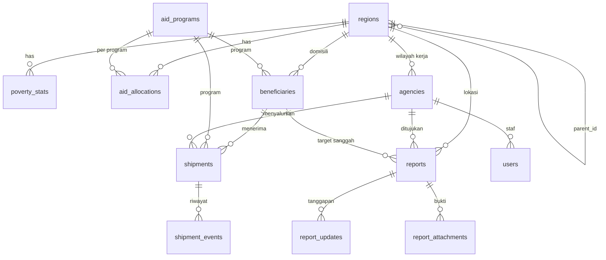

# Database — HakWarga (hakwarga.web.id)

> Pemilik: K (Backend). Terkait: `structure.md` · `prd.md` §8 · `AGENTS.md`
> Identifier: **Inggris, snake_case**. Skema ini menggantikan draf awal berbahasa Indonesia di percakapan sebelumnya.

---

## 1. Pilihan Database: PostgreSQL 16+

| Kebutuhan proyek | Mengapa PostgreSQL cocok |
|---|---|
| Median pembanding anomali per level/program/periode | `percentile_cont(0.5) WITHIN GROUP (...)` bawaan |
| Skor SLA per instansi dalam satu query | `COUNT(*) FILTER (WHERE …)`, CTE |
| Scorecard & anomali sebagai turunan transparan | `VIEW` (bisa dinaikkan jadi *materialized view*) |
| Integritas data | Foreign key, `UNIQUE`, `CHECK`, tipe `numeric` presisi |
| Tumbuh nanti | PostGIS, JSONB, partial index, full-text bila dibutuhkan |
| Biaya | Gratis, banyak penyedia terkelola |

**Dibanding alternatif:** MySQL tidak punya `percentile_cont` bawaan; SQLite tidak cocok untuk produksi dan menyembunyikan masalah view/agregat di tes.

**PostGIS ditunda.** Polygon peta disajikan sebagai file GeoJSON statis berkunci kode wilayah; kita tidak memerlukan query spasial di MVP. Aktifkan PostGIS hanya bila nanti perlu "laporan dalam radius X".

**Aturan:** tes & CI memakai PostgreSQL (bukan SQLite). Versi lokal = produksi = 16.

---

## 2. ERD



---

## 3. Tabel

Semua tabel punya `id` (bigint PK, auto) dan `created_at`/`updated_at` kecuali dinyatakan lain. `is_simulated` = data demo (selalu `true` untuk data penerima/penyaluran/laporan di MVP).

### 3.1 `regions`
| Kolom | Tipe | Null | Catatan |
|---|---|---|---|
| bps_code | varchar(10) | – | **unique**. Prov 2 digit · kab/kota 4 · kec 7 · desa 10 (samakan dengan GeoJSON) |
| name | varchar(120) | – | |
| level | smallint | – | 1 provinsi · 2 kab/kota · 3 kecamatan · 4 desa/kelurahan |
| parent_id | bigint FK→regions | ✔ | |
| population | integer | ✔ | |
| is_pilot | boolean | – | default false; wilayah pilot punya data penerima |

### 3.2 `poverty_stats` (data **riil** BPS)
| Kolom | Tipe | Null | Catatan |
|---|---|---|---|
| region_id | FK | – | |
| year | smallint | – | |
| poverty_percent | numeric(5,2) | – | Persentase penduduk miskin (P0) |
| poor_population | integer | ✔ | **Jiwa** (importer mengonversi dari ribu jiwa) |
| source / source_url | varchar | – / ✔ | Wajib untuk setiap baris |
| | | | `UNIQUE(region_id, year)` |

### 3.3 `aid_programs`
| Kolom | Tipe | Catatan |
|---|---|---|
| code | varchar(16) unique | `PKH`, `BPNT`, … |
| name | varchar(120) | |
| description | text null | |
| cash_value | bigint | Rupiah per periode (**nilai contoh/simulasi**) |
| goods_value | bigint | Rupiah |
| goods_description | varchar(160) null | |
| frequency | varchar(20) | `monthly` · `quarterly` · `one_time` |
| is_active | boolean | |

### 3.4 `aid_allocations` (kuota per wilayah)
| Kolom | Tipe | Catatan |
|---|---|---|
| region_id, program_id | FK | |
| period | char(7) | `YYYY-MM` |
| quota_recipients | integer | |
| actual_recipients | integer null | |
| budget | bigint null | |
| is_simulated | boolean default true | |
| | | `UNIQUE(region_id, program_id, period)` |

### 3.5 `agencies`
| Kolom | Tipe | Catatan |
|---|---|---|
| name | varchar(160) | |
| slug | varchar(180) | **unique**, dipakai di URL |
| type | varchar(40) | enum `AgencyType` |
| region_id | FK | |
| is_simulated | boolean | |

### 3.6 `beneficiaries` (hanya wilayah pilot)
| Kolom | Tipe | Catatan |
|---|---|---|
| public_id | char(26) | **ULID**, unique; dipakai di UI/API (bukan `id`) |
| region_id, program_id | FK | |
| nik_hash | char(64) | `HMAC-SHA256(nik, pepper)`; **tidak ada NIK mentah di mana pun** |
| masked_name | varchar(60) | mis. `S*** W***` |
| masked_address | varchar(120) null | mis. `RT 03/RW 05` |
| eligibility_status | varchar(20) | `eligible` · `under_review` · `disputed` · `removed` |
| is_simulated | boolean | |
| | | `UNIQUE(program_id, nik_hash)` |

### 3.7 `shipments` (satu resi = satu penyaluran)
| Kolom | Tipe | Catatan |
|---|---|---|
| receipt_code | varchar(24) | **unique**, format `HWR-…` |
| beneficiary_id, program_id, agency_id | FK | |
| period | char(7) | |
| entitled_cash | bigint | Hak tunai (Rp) |
| entitled_goods_value | bigint | Hak barang (Rp) |
| entitled_goods_description | varchar(160) null | |
| current_status | varchar(32) | enum `ShipmentStatus` (disalin dari event terakhir) |
| distribution_point | varchar(120) null | |
| is_simulated | boolean | |

### 3.8 `shipment_events`
| Kolom | Tipe | Catatan |
|---|---|---|
| shipment_id | FK cascade | |
| status | varchar(32) | |
| occurred_at | timestamp | |
| agency_id | FK null | |
| user_id | FK null | Petugas yang mencatat |
| note | varchar(255) null | |

### 3.9 `reports`
| Kolom | Tipe | Catatan |
|---|---|---|
| ticket_code | varchar(16) | **unique**, `HWT-…` |
| secret_hash | char(64) | `sha256(kode_rahasia_normal)`; bandingkan dengan `hash_equals` |
| type | varchar(20) | `extortion` · `dispute` |
| category | varchar(40) | lihat §4 |
| region_id | FK | |
| agency_id | FK null | |
| program_id | FK null | |
| target_beneficiary_id | FK null | **hanya `dispute`**; **tidak ada** kolom resi/penerima untuk `extortion` |
| amount_claimed | bigint null | Nominal potongan (opsional) |
| description | text | **Tidak pernah publik**; sudah melewati `PiiMasker` |
| status | varchar(20) | enum `ReportStatus` |
| first_response_at | timestamp null | Diisi otomatis pada tanggapan staf pertama |
| resolved_at | timestamp null | |
| is_simulated | boolean | |

### 3.10 `report_updates`
`report_id` (FK cascade) · `status` · `message` (text) · `is_public` (bool, default true) · `user_id` (FK null) · `created_at`.
Bertindak sebagai **jejak audit** perubahan status.

### 3.11 `report_attachments`
`report_id` (FK cascade) · `disk` · `path` · `mime` · `size_bytes` · `sha256` (hash berkas yang sudah dibersihkan) · `created_at`. Disk **privat**; tidak pernah diakses lewat URL publik.

### 3.12 `users`
Bawaan Laravel + `role` (varchar(20)) + `agency_id` (FK null).

### 3.13 Tabel bawaan Laravel
`migrations`, `sessions`, `cache`, `cache_locks`, `jobs`, `failed_jobs`, `password_reset_tokens`.

---

## 4. Enum (PHP backed enum, disimpan sebagai `string`)

Memakai `string` + cast enum (bukan tipe `enum` DB) agar mudah diubah via migrasi.

| Enum | Nilai |
|---|---|
| `ShipmentStatus` | `data_collected` · `eligibility_verified` · `scheduled` · `in_delivery` · `received_at_point` |
| `ReportType` | `extortion` · `dispute` |
| `ReportStatus` | `submitted` · `verified` · `forwarded` · `in_progress` · `resolved` · `rejected` |
| `EligibilityStatus` | `eligible` · `under_review` · `disputed` · `removed` |
| `RegionLevel` | `1` provinsi · `2` kab/kota · `3` kecamatan · `4` desa |
| `AgencyType` | `provincial_social_office` · `regency_social_office` · `district_office` · `village_office` · `distributor` |
| `UserRole` | `super_admin` · `moderator` · `agency_officer` |
| `AnomalyFlag` | `under_coverage` · `over_coverage` · `normal` |
| `ExtortionCategory` | `cash_deduction` · `admin_fee` · `card_withheld` · `goods_shortfall` · `forced_purchase` · `other` |
| `DisputeCategory` | `not_eligible` · `duplicate` · `deceased_or_moved` · `eligible_but_omitted` · `other` |

Label Bahasa Indonesia ada di `lang/id/enums.php` (tiap enum punya method `label()`).

---

## 5. Index & Constraint

| Tabel | Index |
|---|---|
| regions | `UNIQUE(bps_code)` · `(parent_id)` · `(level)` |
| poverty_stats | `UNIQUE(region_id, year)` |
| aid_allocations | `UNIQUE(region_id, program_id, period)` · `(program_id, period)` |
| agencies | `UNIQUE(slug)` · `(region_id)` |
| beneficiaries | `UNIQUE(public_id)` · `UNIQUE(program_id, nik_hash)` · `(region_id)` |
| shipments | `UNIQUE(receipt_code)` · `(beneficiary_id)` · `(agency_id, current_status)` · `(program_id, period)` |
| shipment_events | `(shipment_id, occurred_at)` |
| reports | `UNIQUE(ticket_code)` · `(agency_id, status)` · `(region_id, created_at)` · `(status)` |
| report_updates | `(report_id, created_at)` |

`CHECK` yang disarankan: `poverty_percent BETWEEN 0 AND 100`, `quota_recipients >= 0`, `entitled_cash >= 0`, `level BETWEEN 1 AND 4`.

---

## 6. View & Query Analitik

Rumus bisnis: `prd.md` §8. **Ambang tidak di-hardcode di SQL** — view hanya menghitung angka; flag/severity ditetapkan `AnomalyService` dari `config/hakwarga.php`.

### 6.1 `v_anomaly_scores`
```sql
CREATE OR REPLACE VIEW v_anomaly_scores AS
WITH latest_poverty AS (
  SELECT DISTINCT ON (region_id)
         region_id, poverty_percent, poor_population, year
  FROM poverty_stats
  ORDER BY region_id, year DESC
),
base AS (
  SELECT a.region_id, a.program_id, a.period, r.level, r.parent_id,
         a.quota_recipients,
         COALESCE(lp.poor_population,
                  ROUND(r.population * lp.poverty_percent / 100.0)) AS poor_estimate
  FROM aid_allocations a
  JOIN regions r         ON r.id = a.region_id
  JOIN latest_poverty lp ON lp.region_id = a.region_id
  WHERE r.population > 0
),
ratios AS (
  SELECT *, quota_recipients::numeric / NULLIF(poor_estimate, 0) AS targeting_ratio
  FROM base
),
medians AS (
  SELECT program_id, period, level,
         percentile_cont(0.5) WITHIN GROUP (ORDER BY targeting_ratio) AS median_ratio
  FROM ratios
  GROUP BY program_id, period, level
)
SELECT r.region_id, r.program_id, r.period, r.level, r.parent_id,
       r.quota_recipients, r.poor_estimate, r.targeting_ratio, m.median_ratio,
       r.targeting_ratio / NULLIF(m.median_ratio, 0) AS relative_ratio
FROM ratios r
JOIN medians m USING (program_id, period, level);
```
Jika lambat saat seed besar → ubah menjadi `MATERIALIZED VIEW` + `REFRESH` di `hw:cache-warm`.

### 6.2 SLA instansi (query di `SlaScoreService`, bind batas via parameter)
```sql
WITH r AS (
  SELECT agency_id, created_at, first_response_at, resolved_at,
         (first_response_at IS NOT NULL
            OR now() - created_at > CAST(? AS interval))           AS resp_due,
         (first_response_at IS NOT NULL
            AND first_response_at - created_at <= CAST(? AS interval)) AS resp_ok,
         (resolved_at IS NOT NULL
            OR now() - created_at > CAST(? AS interval))           AS resolve_due,
         (resolved_at IS NOT NULL
            AND resolved_at - created_at <= CAST(? AS interval))   AS resolve_ok
  FROM reports
  WHERE agency_id IS NOT NULL AND status <> 'rejected'
)
SELECT agency_id,
       COUNT(*)                                   AS total_reports,
       COUNT(*) FILTER (WHERE resp_due)           AS resp_due_count,
       COUNT(*) FILTER (WHERE resp_ok)            AS resp_ok_count,
       COUNT(*) FILTER (WHERE resolve_due)        AS resolve_due_count,
       COUNT(*) FILTER (WHERE resolve_ok)         AS resolve_ok_count,
       percentile_cont(0.5) WITHIN GROUP (
         ORDER BY EXTRACT(EPOCH FROM (first_response_at - created_at)) / 3600
       ) FILTER (WHERE first_response_at IS NOT NULL) AS median_first_response_hours
FROM r
GROUP BY agency_id;
```
Bind: `'72 hours'`, `'72 hours'`, `'14 days'`, `'14 days'` (dari config). Skor dihitung di PHP:
```
skor = w_resp × (resp_ok_count / resp_due_count) + w_resolve × (resolve_ok_count / resolve_due_count)
masuk peringkat bila resp_due_count >= min_due_reports
```
Bagi-nol → perlakukan sebagai "belum cukup data".

### 6.3 Pola query umum
```php
// Tracker: satu query + eager load
Shipment::with(['events' => fn ($q) => $q->orderBy('occurred_at'), 'program', 'agency', 'beneficiary:id,masked_name,masked_address'])
    ->where('receipt_code', $code)->first();

// Hitung laporan agregat per wilayah (tanpa isi laporan)
Report::query()->select('region_id', DB::raw('count(*) as total'))->groupBy('region_id');
```

---

## 7. Seeding

Seeder **idempoten** dan berurutan; angka acak memakai `mt_srand(2026)` agar demo konsisten.

| Urutan | Seeder | Sumber | Isi |
|---|---|---|---|
| 1 | `AidProgramSeeder` | manual | PKH, BPNT (nilai **contoh**, verifikasi ke Kemensos bila akan dikutip) |
| 2 | `RegionSeeder` | `database/data/regions.csv` (**riil**) | Provinsi + kab/kota (+ kecamatan/desa wilayah pilot) |
| 3 | `PovertyStatSeeder` | `database/data/poverty.csv` (**riil**, BPS) | Persentase & jumlah penduduk miskin |
| 4 | `AgencySeeder` | generator | Dinsos prov/kab + kecamatan/kelurahan pilot |
| 5 | `AidAllocationSeeder` | generator | Kuota 2026-10 per wilayah & program, sintetis |
| 6 | `BeneficiarySeeder` | Faker `id_ID` | ±1.500 penerima di wilayah pilot; NIK palsu → `nik_hash` |
| 7 | `ShipmentSeeder` | generator | Resi + events; sebaran status 10/15/20/25/30% |
| 8 | `ReportSeeder` | generator | ±60 laporan dengan waktu respon bervariasi (untuk scorecard) |
| 9 | `UserSeeder` | env | Admin demo `admin@hakwarga.test` **hanya bila** `HW_SEED_DEMO_USERS=true`; sandi dari `HW_DEMO_PASSWORD` (jangan di-commit, jangan aktif di production) |
| 10 | `DemoScenarioSeeder` | tetap | Skenario "emas" di bawah |

### 7.1 Skenario demo tetap (untuk juri & video)
| Kode | Isi |
|---|---|
| `HWR-PKH-2610-DEMO01` | PKH · status *Dalam Pengiriman* · 3 event · hak tunai contoh |
| `HWR-BPNT-2610-DEMO02` | BPNT · status *Penjadwalan* · hak berupa paket barang |
| `HWR-PKH-2610-DEMO03` | PKH · status *Diterima di Titik Salur* · dipakai demo tombol "Ada yang tidak sesuai?" |
| `HWT-2026-DEMO01` | Tiket pungli · status *Diproses* · 2 tanggapan publik · kode rahasia demo tercantum di README |
| Anomali tersuntik | ±8 wilayah *under_coverage* (kuota ×0,3) dan ±6 *over_coverage* (kuota ×2,0), didokumentasikan di `DemoScenarioSeeder` |

Semua baris sintetis: `is_simulated = true` → UI menampilkan label **SIMULASI**.

### 7.2 Etika data
- Data kemiskinan & wilayah **riil**; angka kuota/penerima **fiktif**. Karena itu **setiap** peta/scorecard memuat banner "Data simulasi untuk demonstrasi — bukan temuan atas wilayah/instansi sebenarnya" (GEN-02).
- Jika ditemukan data agregat bansos riil (Q-06), simpan terpisah dengan `is_simulated=false`, cantumkan sumber & tanggal.

---

## 8. Privasi di Level Data

- NIK: **tidak pernah** disimpan/dilog/ditampilkan mentah; hanya `nik_hash` (HMAC + pepper di `.env`).
- `beneficiaries` hanya berisi nama/alamat **tersamar**.
- `reports` untuk tipe `extortion` **tidak** menyimpan referensi resi/penerima.
- Tidak ada kolom IP, user agent, atau lokasi presisi pada tabel laporan.
- `description` & lampiran **tidak pernah** tampil di halaman publik/API.
- Log aplikasi tidak memuat body request `/lapor/*`.
- Lampiran: re-encode gambar (hapus EXIF), nama berkas acak, disk privat, unduhan hanya via panel admin.
- Retensi (usulan untuk proposal): lampiran dihapus setelah laporan `resolved`/`rejected` + 90 hari.

---

## 9. Urutan Migrasi

```
2026_10_30_000001_create_regions_table
2026_10_30_000002_create_poverty_stats_table
2026_10_30_000003_create_aid_programs_table
2026_10_30_000004_create_aid_allocations_table
2026_10_30_000005_create_agencies_table
2026_10_30_000006_create_beneficiaries_table
2026_10_30_000007_create_shipments_table
2026_10_30_000008_create_shipment_events_table
2026_10_30_000009_add_role_and_agency_to_users_table
2026_11_02_000010_create_reports_table
2026_11_02_000011_create_report_updates_table
2026_11_02_000012_create_report_attachments_table
2026_11_03_000013_create_v_anomaly_scores_view
```
Aturan: **jangan mengubah migrasi yang sudah di-merge ke `main`**; buat migrasi baru. Bagian `down()` untuk view memakai `DROP VIEW IF EXISTS`.

---

## 10. Pengujian Database

- `LazilyRefreshDatabase` + PostgreSQL (`hakwarga_test`).
- Tes unit `AnomalyService` dengan fixture kecil (median diketahui → flag diketahui).
- Tes `SlaScoreService`: laporan belum jatuh tempo **tidak** menurunkan skor; minimal 5 laporan jatuh tempo.
- Tes privasi: setelah `POST /lapor/pungli`, tidak ada kolom/log yang berisi IP; deskripsi dengan 16 digit tersamarkan.
- Tes `receipt_code` & `ticket_code`: unik, cocok regex, tanpa karakter ambigu.
