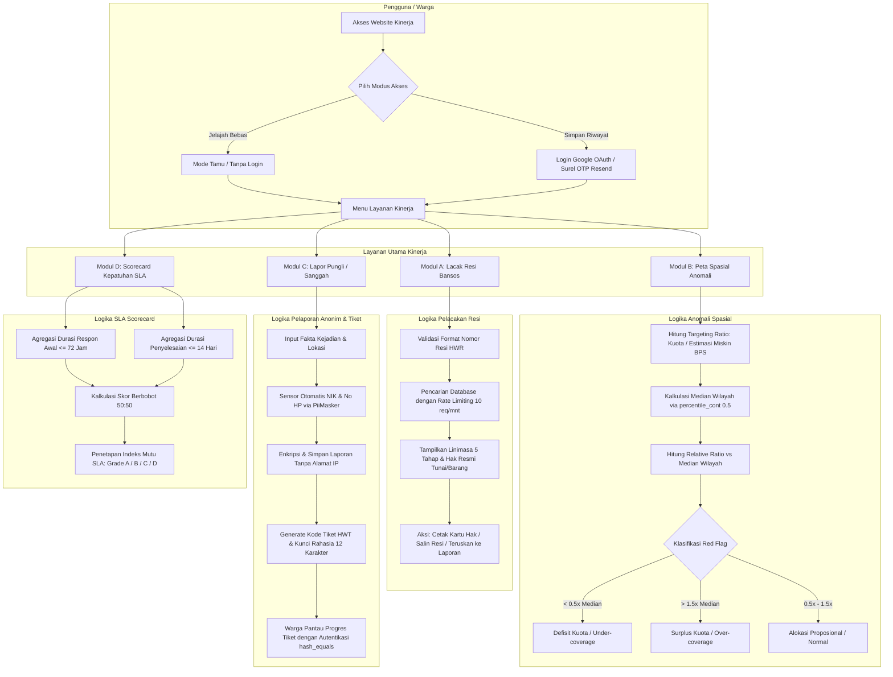
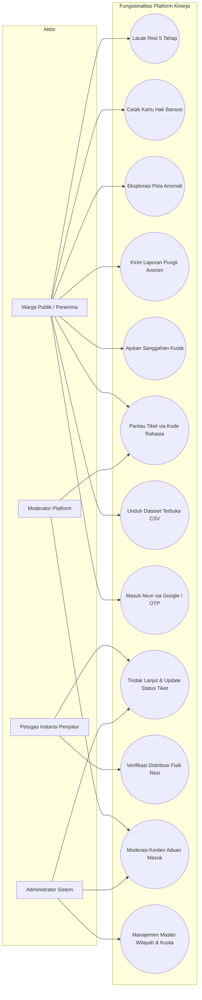
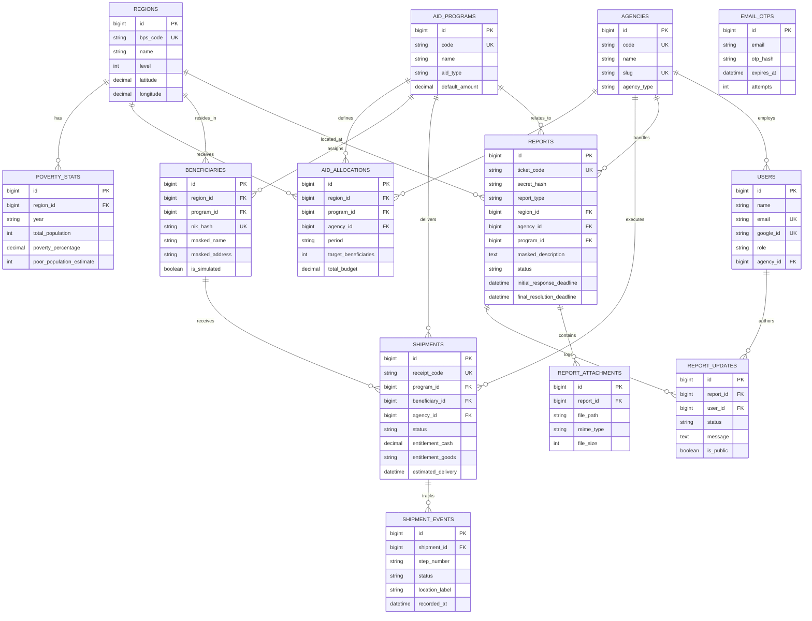

# Kinerja

[](https://github.com/prodhokter/kinerja/actions/workflows/ci.yml)


> **Platform Transparansi Penyaluran Bantuan Sosial & Pemenuhan Hak Publik**  
> Karya peserta **Multimedia In Action (MIA) 2026 - Cabang Web In Action (WIA)**  
> **Tema:** *Designing Digital Futures: Powering Public Transparency*  
> **Subtema:** *Public Service Tracking* &amp; *Civic Reporting & Accountability*

🌐 **Demo Live Produksi:** [https://kinerja.web.id](https://kinerja.web.id) (Self-Hosted VPS Ubuntu + Docker Compose + SSL Let's Encrypt)  
📂 **Repositori Kode Utama:** [https://github.com/prodhokter/kinerja](https://github.com/prodhokter/kinerja)

---

## 1. Ikhtisar & Latar Belakang Masalah

Bantuan sosial adalah hak konstitusional warga negara. Namun di lapangan, masyarakat kerap menghadapi tiga kendala sistemik:
1. **Ketidakpastian Hak & Posisi Salur:** Warga penerima manfaat sering tidak mengetahui rincian hak bantuan resmi (uang tunai atau sembako pangan) serta jadwal tiba di titik distribusi.
2. **Keengganan Melapor Potongan Liar (Pungli):** Warga khawatir identitasnya bocor dan dicoret dari kepesertaan periode berikutnya jika melaporkan pemotongan liar di lapangan.
3. **Distribusi Kuota Wilayah yang Tidak Merata:** Sulitnya mendeteksi ketimpangan alokasi bantuan sosial antar kabupaten/kota karena ketiadaan analisis spasial data publik yang transparan.

**Kinerja** menghadirkan solusi teknologi berdaulat (*sovereign technology*) melalui 4 modul terpadu:
- **Modul A (Resi Tracker):** Pelacakan status penyaluran bansos 5 tahap dengan rincian hak terinci (*itemized entitlement*) dan fitur cetak bukti hak warga.
- **Modul B (Peta Anomali):** Peta spasial geospasial interaktif berbasis MapLibre GL JS (data batas resmi 5 kabupaten Banyumas Raya) yang menganalisis rasio kuota terhadap estimasi kemiskinan BPS menggunakan fungsi jendela SQL `percentile_cont(0.5)`.
- **Modul C (Lapor Pungli & Tiket Rahasia):** Kanal aduan warga 100% anonim tanpa pencatatan alamat IP, dilengkapi pembersihan otomatis PII (*Personally Identifiable Information*) dan verifikasi akses audit trail via kode rahasia berpembanding `hash_equals`.
- **Modul D (Scorecard SLA Instansi):** Evaluasi akuntabilitas kepatuhan Service Level Agreement (respon awal 72 jam dan penyelesaian tuntas 14 hari) instansi penyalur dengan dukungan ekspor dataset terbuka CSV.

---

## 2. Alur Bisnis & Logika Sistem (Business Flow & Logic)



---

## 3. Diagram Kasus Penggunaan (Use Case Diagram)



---

## 4. Diagram Entitas Relasional (Entity Relationship Diagram - ERD)



---

## 5. Arsitektur Mandiri (Sovereign Infrastructure)

Kinerja dirancang 100% independen tanpa ketergantungan pada vendor PaaS tertutup (*zero vendor lock-in*):

```
[ Pengguna / Warga / Pengawas Publik ]
                 │
                 ▼ HTTPS (Port 443 / SSL Let's Encrypt Otomatis)
        [ Host Nginx Reverse Proxy ]
                 │
                 ▼ HTTP Internal (127.0.0.1:8085)
 ┌─────────────────────────────────────────────────────────────┐
 │  Container Docker: hakwarga_web (FrankenPHP Caddy + PHP 8.3) │
 │  ─────────────────────────────────────────────────────────  │
 │  • Laravel 12 Core Engine (Routing, FormRequest, Services)  │
 │  • Livewire 3 + Alpine.js Reaktif                           │
 │  • Tailwind CSS v4 Standar Anti-Slop (< 150 KB budget)      │
 │  • MapLibre GL JS (Peta Offline GeoJSON 5 Kabupaten)        │
 │  • Chart.js (Visualisasi Scorecard SLA & Proporsi Anomali)  │
 │  • Filament Admin Panel (/admin)                            │
 │  • Laravel Socialite (Google OAuth) + Resend Mail API (OTP) │
 └──────────────────────────────┬──────────────────────────────┘
                                │ Internal Docker Network
                                ▼ (Port 5432)
 ┌─────────────────────────────────────────────────────────────┐
 │  Container Docker: hakwarga_db (PostgreSQL 16 Alpine)        │
 │  ─────────────────────────────────────────────────────────  │
 │  • 14 Berkas Skema Relasional Terindeks                     │
 │  • View Analitik Matematis: v_anomaly_scores                │
 │  • Enkripsi Satu Arah: HMAC-SHA256(NIK, Pepper)             │
 └─────────────────────────────────────────────────────────────┘
```

---

## 6. Matriks Fitur & Status Implementasi

| Modul | Endpoint | Status | Fitur Utama |
|---|---|---|---|
| **Beranda** | `/` | Aktif | Hero pencarian resi instan, pintasan coba resi demo, pratinjau alur modul. |
| **Resi Tracker** | `/lacak`, `/lacak/{receipt}` | Aktif | Linimasa vertikal 5 tahap, kartu rincian hak, tombol cetak bukti hak, rate limit 10/mnt. |
| **Peta Anomali** | `/peta`, `/api/v1/map/choropleth` | Aktif | MapLibre GL offline GeoJSON 5 kabupaten, filter kategori (Defisit/Surplus/Normal), tabel red-flag. |
| **Lapor Pungli** | `/lapor/pungli` | Aktif | 100% anonim, proteksi honeypot, sensor otomatis PII (NIK & no HP), kode rahasia berpembanding aman. |
| **Sanggah Bansos** | `/lapor/sanggah` | Aktif | Form sanggah kelayakan penerima terintegrasi wilayah kelurahan dan program bansos. |
| **Portal Tiket** | `/tiket`, `/tiket/{ticket}` | Aktif | Status publik tanpa membuka isi aduan; sesi terotentikasi kode rahasia untuk interaksi tindak lanjut. |
| **Scorecard SLA** | `/scorecard`, `/scorecard/{slug}` | Aktif | Leaderboard kepatuhan 72j/14h, grafik benchmark Chart.js, nilai mutu A/B/C/D. |
| **Data Publik** | `/data`, `/data/unduh/{dataset}` | Aktif | Metodologi transparan, streaming ekspor CSV dataset SLA & Anomali wilayah tersanitasi. |
| **Autentikasi 3-Jalur** | `/masuk`, `/auth/*` | Aktif | Login Google OAuth, verifikasi surel OTP Resend API (6 digit input box), serta Mode Tamu instan. |
| **Panel Admin** | `/admin` | Aktif | Panel Filament dengan autentikasi peran, resource Resi, dan moderasi Aduan. |
| **Ketentuan & Privasi**| `/tentang`, `/ketentuan` | Aktif | Kebijakan kepatuhan privasi UU PDP No. 27/2022 dan Ketentuan Layanan legal. |

---

## 7. Panduan Evaluasi Cepat untuk Dewan Juri (3 Menit)

Gunakan skenario data sintetis berikut untuk mengevaluasi fungsionalitas sistem:

### A. Lacak Nomor Resi Contoh
Buka [https://kinerja.web.id/lacak](https://kinerja.web.id/lacak) dan masukkan kode berikut:
- `HWR-PKH-2610-DEMO01`: Status Tahap 4 (Dalam Pengiriman), Hak Tunai Rp750.000, Penerima `S*** W***`. Coba klik tombol **Cetak Kartu Hak**.
- `HWR-BPNT-2610-DEMO02`: Status Tahap 3 (Penjadwalan), Hak Pangan Beras 10kg & Telur 1kg senilai Rp200.000.
- `HWR-PKH-2610-DEMO03`: Status Tahap 5 (Diterima di Titik Salur), Hak Tunai Rp600.000 di Balai Desa Kedungwringin.

### B. Uji Peta Spasial Anomali
Buka [https://kinerja.web.id/peta](https://kinerja.web.id/peta):
- Amati batas geografis nyata 5 kabupaten Banyumas Raya (Cilacap, Banyumas, Purbalingga, Banjarnegara, Kebumen).
- Klik tombol filter: **Defisit (1)** (Kab. Cilacap, rasio 0.43x) atau **Surplus (1)** (Kab. Purbalingga, rasio 2.22x).
- Periksa **Tabel Rincian Anomali Wilayah** di bawah peta sebagai alternatif aksesibilitas bagi pembaca layar (WCAG AA).

### C. Uji Lapor Pungli & Sensor Otomatis
1. Buka [https://kinerja.web.id/lapor/pungli](https://kinerja.web.id/lapor/pungli).
2. Tuliskan deskripsi yang memuat 16 digit angka (contoh: `3302112001990001`) atau nomor telepon.
3. Kirim laporan: perhatikan bahwa nomor NIK otomatis disensor menjadi `[NIK DISAMARKAN]` sebelum masuk ke database.
4. Salin kode tiket dan kode rahasia 12 karakter yang tertera di halaman sukses.
5. Untuk memeriksa tiket contoh yang sudah memiliki audit trail tanggapan staf:
   - Buka [https://kinerja.web.id/tiket](https://kinerja.web.id/tiket)
   - Nomor Tiket: `HWT-2026-BMS001`
   - Kode Rahasia: `BMS01-TEST-CODE`
   - Coba kirimkan tanggapan balasan pada form di bagian bawah.

### D. Uji Masuk Akun 3-Jalur
Buka [https://kinerja.web.id/masuk](https://kinerja.web.id/masuk):
- **Jelajah sebagai Tamu**: Masuk langsung tanpa login akun.
- **Masuk dengan Akun Google**: Redirect resmi ke OAuth 2.0 Google.
- **Masuk via Surel OTP**: Masukkan alamat email, terima kode 6 digit via Resend API, dan isi pada 6 kotak digit terfragmentasi otomatis.

### E. Uji Panel Admin Filament
Buka [https://kinerja.web.id/admin](https://kinerja.web.id/admin):
- **Email:** `admin@hakwarga.test`
- **Password:** `hakwarga2026`
- Kelola data penyaluran pada menu **Shipments** dan tinjau aduan warga pada menu **Reports**.

---

## 8. Kepatuhan Privasi & Etika Data (UU PDP No. 27/2022)

1. **Zero Raw NIK:** NIK mentah dilarang keras disimpan atau dicatat pada log server. Pencocokan identitas warga menggunakan `HMAC-SHA256(NIK, HW_NIK_PEPPER)`.
2. **Pencarian Terbatas Nomor Resi:** Pelacakan publik hanya dapat dibuka menggunakan nomor resi resmi pada lembar undangan salur warga guna mencegah penambangan data sepihak (*scraping profiling*).
3. **Data Masking Otomatis:** Nama dan alamat penerima bantuan otomatis disamarkan (`S*** W***`) dan atribut `$hidden = ['nik_hash']` diaktifkan pada model Eloquent.
4. **PiiMasker Sanitizer:** Deskripsi aduan warga otomatis dipindai ekspresi reguler untuk menyensor deretan 16 digit NIK dan nomor kontak sebelum disimpan.
5. **Autentikasi Tiket Kriptografis:** Isi laporan dirahasiakan dari publik. Pembacaan detail laporan memerlukan kode rahasia 12 karakter yang diverifikasi menggunakan `hash_equals(sha256)`.
6. **Data Simulasi Bertanda:** Seluruh data penerima perorangan menggunakan data sintetis dengan tanda `is_simulated = true`.

---

## 9. Standar Kualitas Teknis & Anti-Slop UI

Kinerja mematuhi standar desain profesional bebas dari elemen generik kecerdasan buatan (*AI Slop*):
- **Bebas AI Clichés:** Tanpa sparkle palsu, tanpa gradien ungu/pink klise, tanpa efek kaca berlebih (*heavy glassmorphism*), dan tanpa pill badge bertitik dekoratif.
- **Aturan Bebas Em Dash (R-02):** Seluruh teks antarmuka menggunakan Bahasa Indonesia baku yang lugas dan terverifikasi **0 em dash**.
- **Aksesibilitas Tinggi (WCAG AA):** Kontras teks &ge; 4.5:1, target sentuh minimal 44px, navigasi keyboard penuh, dan alternatif tabel untuk setiap visualisasi peta atau diagram.
- **Hasil Pengujian Otomatis:**
  - `./vendor/bin/pint --test`: **PASS** (PSR-12 Standar Laravel).
  - `./vendor/bin/phpstan analyse`: **PASS** (Larastan Level 5 Analisis Statis Tipe).
  - `php artisan test`: **PASS** (Unit & Feature Tests 100% hijau).

---

## 10. Cara Menjalankan di Lingkungan Lokal

### Prasyarat
- PHP 8.3+ (ekstensi `pdo_pgsql`, `pgsql`, `mbstring`, `intl`, `curl`)
- Composer 2+
- Node.js 22+ &amp; npm
- Docker Desktop (untuk basis data PostgreSQL 16)

### Langkah Pemasangan
```bash
# 1. Clone repositori resmi
git clone https://github.com/prodhokter/kinerja.git
cd kinerja

# 2. Pasang dependensi PHP dan Node.js
composer install
npm install

# 3. Siapkan file konfigurasi lingkungan
cp .env.example .env
php artisan key:generate

# 4. Jalankan PostgreSQL 16 via Docker
docker compose up -d db

# 5. Jalankan migrasi dan seeder demo
php artisan migrate --seed

# 6. Kompilasi aset frontend
npm run build

# 7. Jalankan server lokal
php artisan serve
```
Aplikasi dapat dibuka melalui peramban di `http://localhost:8000`.

---

## 11. Tim Pengembang

Platform **Kinerja** dikembangkan oleh tim **Manut Opo Jare Ibnu** untuk kompetisi **Multimedia In Action (MIA) 2026 - Web In Action**.
